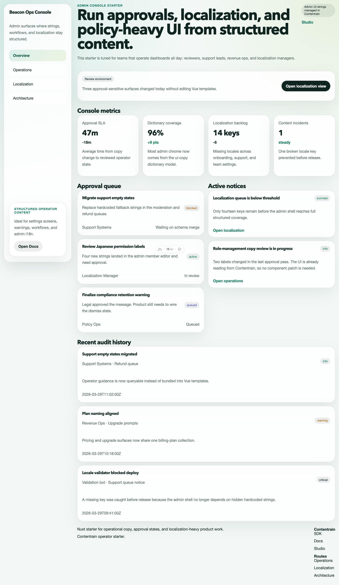
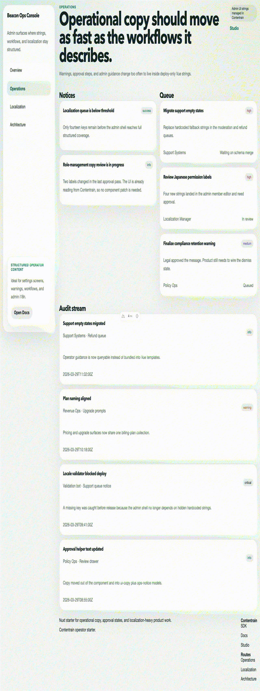

<!-- cover -->
# Contentrain Nuxt Admin Console

A Nuxt 4 starter for internal tools and admin consoles: a dashboard, an approval queue, ops notices, an audit log, settings groups, billing plans and UI strings. All of that copy is content in `.contentrain/`, so none of it is hard-coded in Vue templates.

Built on [Contentrain](https://ai.contentrain.io), the content governance ecosystem for teams and AI agents:
- models, content and the generated typed client live in git next to the code;
- every change is reviewable;
- AI agents edit content through the same validated models as people do.





## What it shows

- **Server-only content reads.** Nitro routes in `server/api/` query the generated `#contentrain` client. Pages and the shared `AdminShell` load the data with `useFetch`, as the [Nuxt guide](https://ai.contentrain.io/guides/frameworks#nuxt-3) recommends. The content stays out of the client bundle.
- **Operator copy as structured content.** Approval states, queue items, notices, audit events and settings matrices are typed collections. Overview, navigation, footer, SEO and site settings are singletons.
- **A dictionary for UI strings.** `ui-copy` holds the admin chrome strings. `/localization` lists them next to the settings and plan names that depend on them.
- **A model overview.** `/architecture` lists the models by domain, read from `.contentrain/models`.

## Use this template

1. Click **[Use this template](https://github.com/new?template_name=contentrain-starter-nuxt-admin-console&template_owner=Contentrain)** to create your own repository.
2. Connect that repository to [Contentrain Studio](https://contentrain.io/studio). Your team can then edit, review and publish the content in the browser, and every change stays a git commit.

## Quick start

Requires Node 22 and pnpm 10.

```bash
pnpm install
pnpm dev
```

| Command | What it does |
|---|---|
| `pnpm dev` | Start the dev server |
| `pnpm check` | Type-check with `nuxt typecheck` |
| `pnpm build` | Production build |
| `pnpm preview` | Serve the production build |
| `pnpm contentrain:generate` | Regenerate `.contentrain/client` after changing models or content |
| `pnpm exec contentrain validate` | Validate models and content |
| `pnpm deploy:netlify` | Build with the Netlify preset |

Demo routes: `/`, `/localization`, `/operations`, `/architecture`.

## Content model

Domains: `system`, `app`, `ops`. Locale: `en`.

| Model | Kind | Domain | Fields |
|---|---|---|---|
| `footer` | singleton | system | `blurb`, `columns`, `legal_notice` |
| `navigation` | singleton | system | `announcement_label`, `cta_href`, `cta_label`, `items` |
| `seo-defaults` | singleton | system | `canonical_base`, `meta_description`, `meta_title`, `og_image` |
| `site-settings` | singleton | system | `default_locale`, `og_image`, `site_name`, `site_tagline`, `theme_name` |
| `billing-plan` | collection | app | `cadence`, `cta_href`, `cta_label`, `featured`, `features`, `name`, `price_label`, `status_badge` |
| `dashboard-overview` | singleton | app | `environment_badge`, `eyebrow`, `primary_cta_href`, `primary_cta_label`, `status_note`, `summary`, `title` |
| `dashboard-stat` | collection | app | `delta`, `label`, `note`, `trend`, `value` |
| `settings-group` | collection | app | `items`, `summary`, `title` |
| `ui-copy` | dictionary | app | (key → value) |
| `work-queue-item` | collection | app | `due_label`, `href`, `owner`, `priority`, `status`, `summary`, `title` |
| `audit-event` | collection | ops | `actor`, `severity`, `summary`, `target`, `timestamp`, `title` |
| `ops-notice` | collection | ops | `body`, `cta_href`, `cta_label`, `title`, `tone` |

Models live in `.contentrain/models/` and content in `.contentrain/content/`. After editing either, run `pnpm contentrain:generate` to refresh the typed client that the server routes import as `#contentrain`.

## Deploy

- Netlify: the build command is `pnpm deploy:netlify` (set in `netlify.toml`). Nitro manages the publish directory.
- Netlify CLI: run `pnpm dlx netlify-cli init` to connect the repository for continuous deployment. If the site already exists, run `pnpm dlx netlify-cli link` instead.
- Any Node host: run `pnpm build`, then `node .output/server/index.mjs`.

[](https://app.netlify.com/start/deploy?repository=https%3A%2F%2Fgithub.com%2FContentrain%2Fcontentrain-starter-nuxt-admin-console)

## Contentrain links

- Contentrain AI, MCP, CLI and SDK: [ai.contentrain.io](https://ai.contentrain.io)
- Query SDK: [ai.contentrain.io/packages/sdk](https://ai.contentrain.io/packages/sdk)
- Nuxt guide: [ai.contentrain.io/guides/frameworks#nuxt-3](https://ai.contentrain.io/guides/frameworks#nuxt-3)
- Contentrain Studio: [contentrain.io/studio](https://contentrain.io/studio)

## License

MIT, see [LICENSE](./LICENSE).
